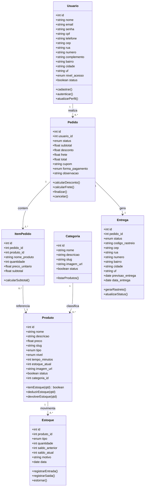
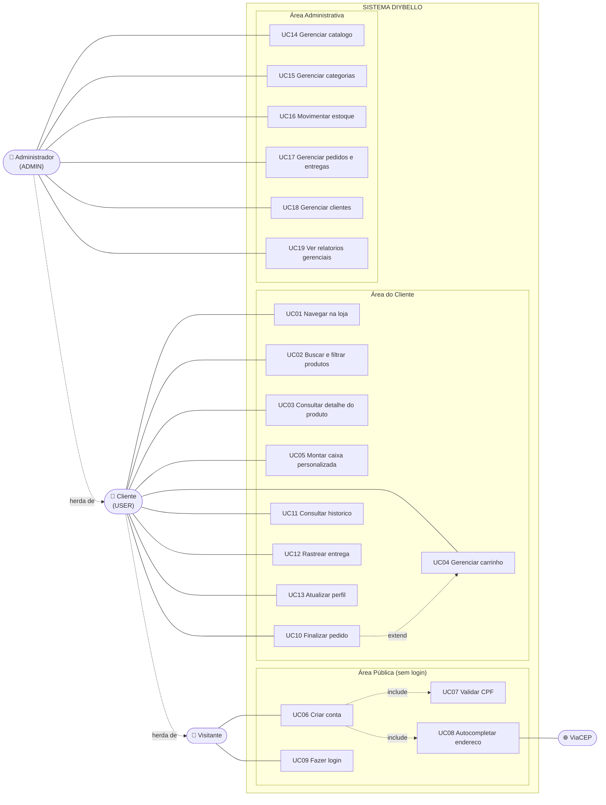
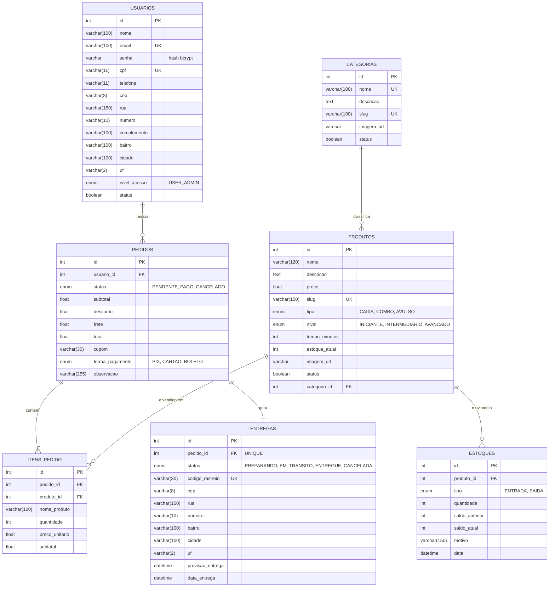
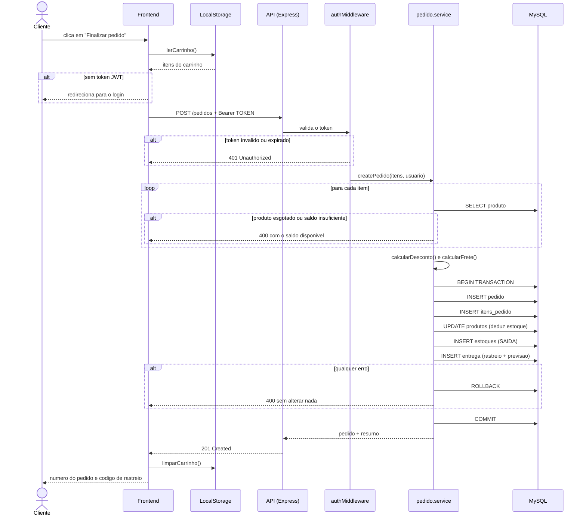
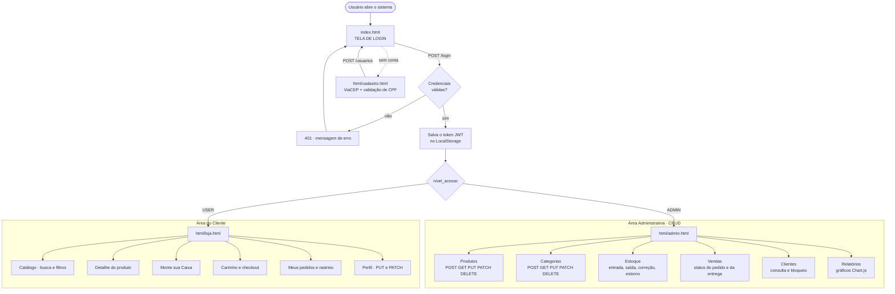
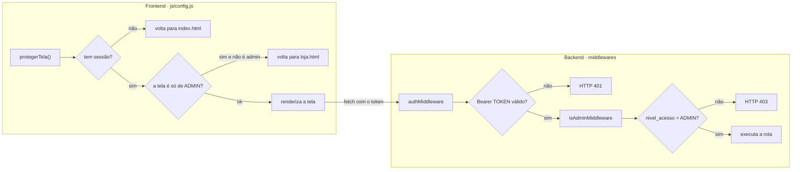
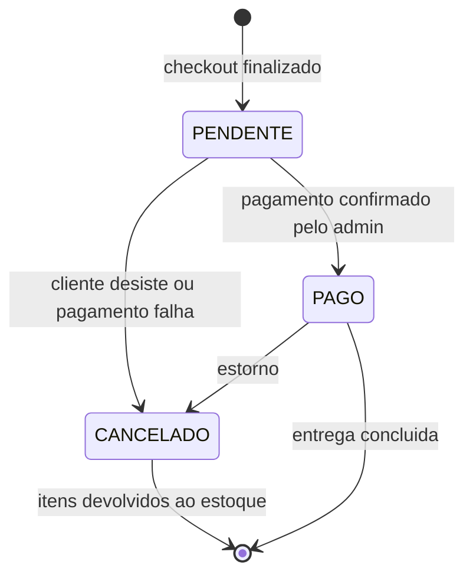
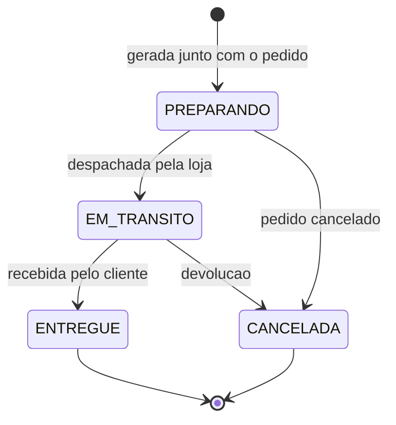
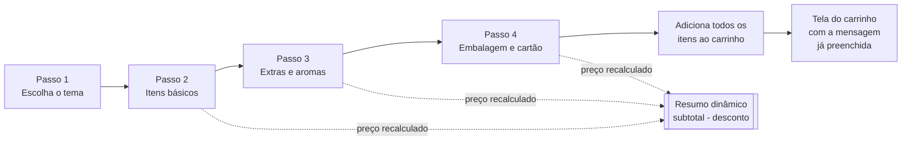

# DIYBELLO — Diagramas de Engenharia

> Os diagramas abaixo estão escritos em **Mermaid**. Para exportar em `.png`,
> cole o bloco de código em [mermaid.live](https://mermaid.live) e use *Actions → PNG*,
> ou instale a extensão *Markdown Preview Mermaid Support* no VS Code e capture a tela.

---

## 1. Diagrama de Classes (UML)

### Cardinalidades

| Relacionamento | Cardinalidade | Chave estrangeira | Ao apagar o pai |
|---|---|---|---|
| Usuario → Pedido | 1 : N | `pedidos.usuario_id` | CASCADE |
| Pedido → ItemPedido | 1 : N | `itens_pedido.pedido_id` | CASCADE |
| ItemPedido → Produto | N : 1 | `itens_pedido.produto_id` | RESTRICT |
| Pedido → Entrega | 1 : 1 | `entregas.pedido_id` (UNIQUE) | CASCADE |
| Categoria → Produto | 1 : N | `produtos.categoria_id` | RESTRICT |
| Produto → Estoque | 1 : N | `estoques.produto_id` | CASCADE |

---

## 2. Diagrama de Casos de Uso

---

## 3. Modelo Entidade-Relacionamento (banco)

---

## 4. Fluxo do Checkout (sequência)

Este é o fluxo mais importante do sistema: converter o carrinho do LocalStorage em uma venda real, deduzindo o estoque dentro de uma transação.

---

## 5. Arquitetura de Acesso: Login como porta de entrada

### Como o bloqueio funciona nas duas camadas

> O frontend evita que a tela abra; o backend garante que o dado não saia.
> Mesmo que alguém digite a URL direto, a API continua devolvendo 401 ou 403.

### Rotas públicas x privadas na API

| Acesso | Endpoints |
|---|---|
| 🔓 **Público** | `POST /login` · `POST /usuarios` · `GET /produtos` · `GET /produtos/:id` · `GET /produtos/buscar` · `GET /categorias` |
| 🔒 **Cliente autenticado** | `GET /usuarios/perfil` · `PUT` e `PATCH /usuarios/:id` · `POST /pedidos` · `GET /pedidos/meus-pedidos` · `GET /entregas/minhas-entregas` |
| 🔒 **Somente ADMIN** | CRUD de `/produtos`, `/categorias`, `/estoque` · `GET /pedidos` · `PATCH /entregas/:id` · `GET /usuarios` · `GET /relatorios/vendas` e `/relatorios/estoque` |

---

## 6. Fluxo de Estados

### 6.1 Status do Pedido

### 6.2 Status da Entrega

---

## 7. Fluxo do "Monte Sua Caixa"

